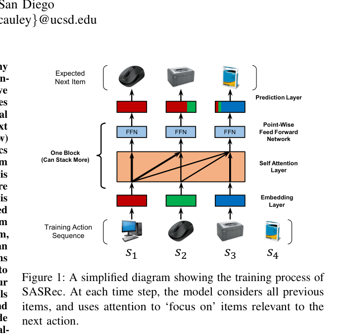

# 序列推荐：GRU、SASRec 与 BERT4Rec 的“单向 vs 双向”之争

电商、短视频与音乐平台的核心任务之一是“下一个交互是什么”。用户的行为天然是有序的点击序列，因此序列推荐是把课程里学到的序列建模能力直接变现的场景：数据易得（MovieLens、Amazon 公开数据集）、模型轻（几百万参数）、指标清晰（HR@K、NDCG@K），是入门推荐系统最合适的一条捷径。

本项目对应课程中的 RNN/LSTM、自注意力与因果掩码、Transformer 编码器、位置编码、负采样与损失函数、序列建模中的信息泄露问题：

- 其一，复现三代代表模型——GRU4Rec（循环网络 + 会话并行训练）、SASRec（单向自注意力 + 因果掩码）、BERT4Rec（双向 Transformer + Cloze 掩码预测），理解“下一项预测”与“掩码项预测”两种训练范式差异；
- 其二，引入图视角的 SR-GNN 把会话内物品构成图做消息传递，与纯序列方法对照；
- 其三，在 MovieLens-1M 与 Amazon-Beauty 上统一划分与评测，重点分析序列长度、长尾物品与流行度偏差对各类方法的影响，并讨论双向训练是否存在“未来信息泄露”的评测陷阱。

预期产出一份“序列长度—模型类型—指标”三维对照表与一份关于短序列场景该选哪种建模方式的结论。该题体量小、结果易复现，也很适合作为后续做工业推荐算法的起点。

## 建议配置与工作量

### 代表性论文

* [Session-based Recommendations with Recurrent Neural Networks（GRU4Rec）](https://arxiv.org/abs/1511.06939)  
* [Self-Attentive Sequential Recommendation（SASRec）](https://arxiv.org/abs/1808.09781)  
* [BERT4Rec: Sequential Recommendation with Bidirectional Encoder Representations from Transformer](https://arxiv.org/abs/1904.06690)  
* [Session-based Recommendation with Graph Neural Networks（SR-GNN）](https://arxiv.org/abs/1811.00855)

### 数据集／开源代码

* [kang205/SASRec：SASRec 官方 TensorFlow 实现与数据预处理脚本（含 MovieLens/Amazon）](https://github.com/kang205/SASRec)  
* [FeiSun/BERT4Rec：BERT4Rec 官方实现与数据处理](https://github.com/FeiSun/BERT4Rec)  
* [MovieLens 公开数据集（GroupLens，含 1M / 20M 版本与字段说明）](https://grouplens.org/datasets/movielens/)